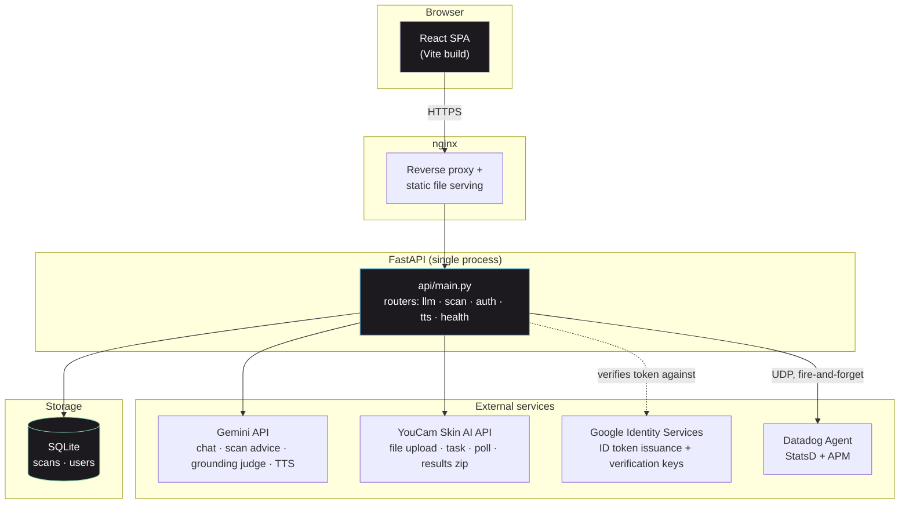
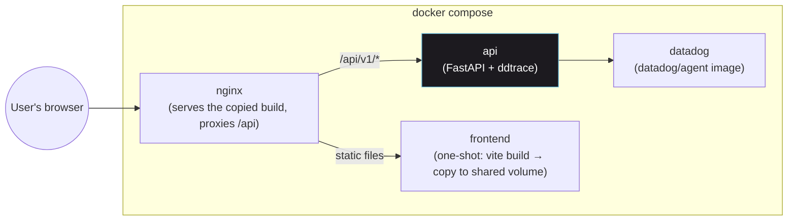
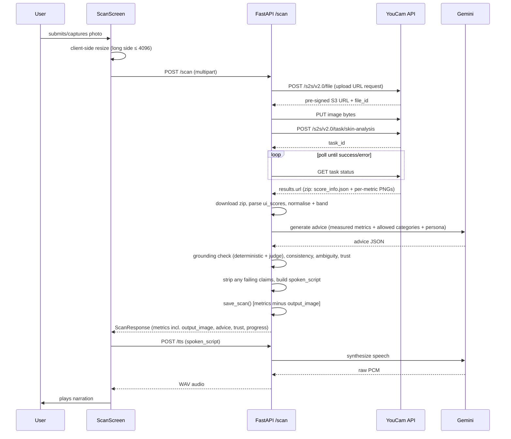
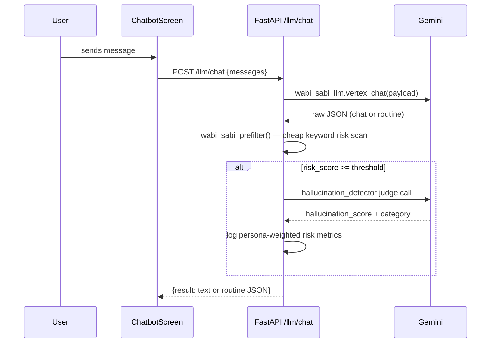
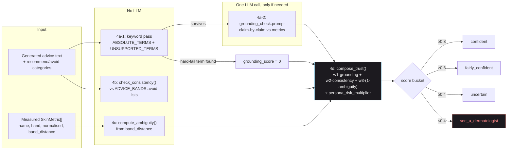
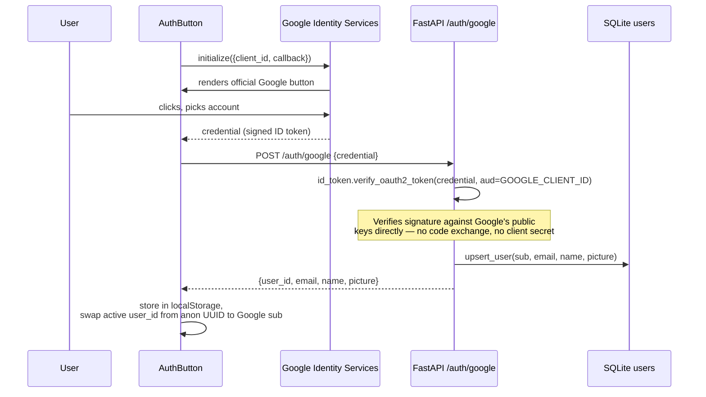
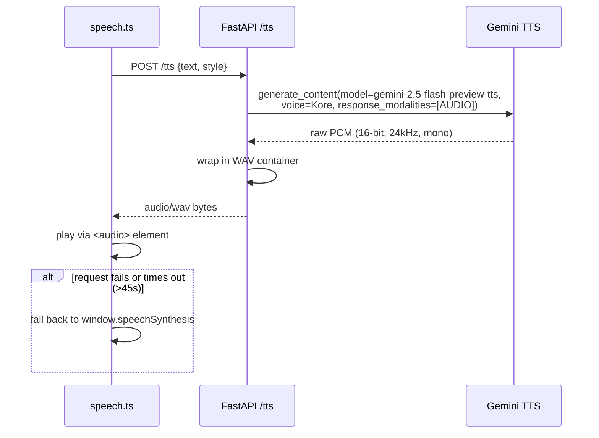
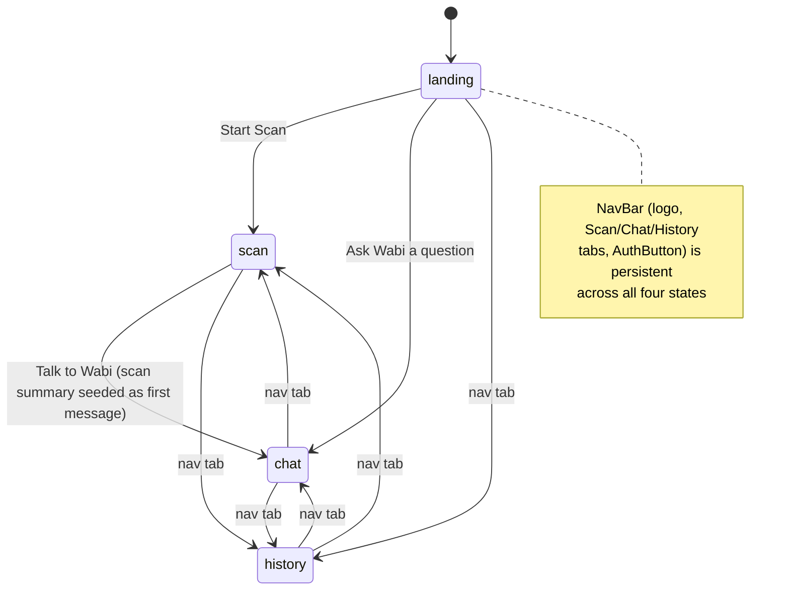
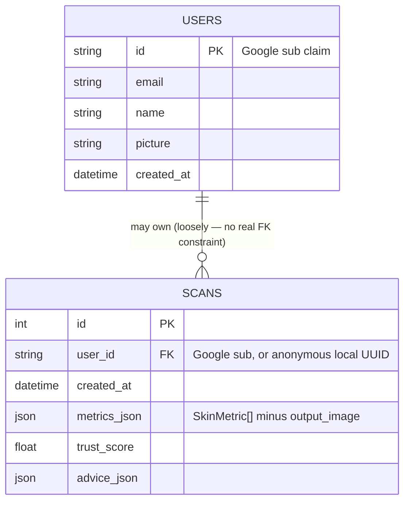

# Wabi-Sabi — Architecture

Technical deep-dive. For the product pitch see [`README.md`](README.md); for the grounding-engine design rationale see [`GROUNDING.md`](GROUNDING.md). This document assumes familiarity with both.

## Contents
- [System overview](#system-overview)
- [Deployment topology](#deployment-topology)
- [Backend layout](#backend-layout)
- [Frontend layout](#frontend-layout)
- [Scan flow (sequence)](#scan-flow-sequence)
- [Chat flow (sequence)](#chat-flow-sequence)
- [Grounding engine internals](#grounding-engine-internals)
- [Auth flow (sequence)](#auth-flow-sequence)
- [Voice / TTS flow (sequence)](#voice--tts-flow-sequence)
- [Frontend screen state machine](#frontend-screen-state-machine)
- [Data model](#data-model)
- [Configuration reference](#configuration-reference)
- [Known limitations / unverified assumptions](#known-limitations--unverified-assumptions)

---

## System overview



Single FastAPI process, single SQLite file, no message queue, no separate auth server. Deliberately minimal — every external dependency is either optional (Datadog, YouCam via mock mode, Google Sign-In) or degrades gracefully (TTS → browser voice).

---

## Deployment topology



All four services read the **same** `env/app.env` via `env_file:` in `docker-compose*.yml` — each ignores whatever variables it doesn't need. One exception: Vite's `VITE_*` variables are baked in at **build time**, before the container ever reads `env_file:`, so they must live in `frontend/.env.local` instead (see [Configuration reference](#configuration-reference)).

`frontend`'s container doesn't run a server — its only job is `cp -a /app/. /frontend/`, copying the Vite build output into a volume that `nginx` serves directly.

---

## Backend layout

```
api/
├── main.py                 FastAPI app, CORS, exception handler, router mounts
├── llm/
│   ├── __init__.py         LLM wrapper around google-genai; two module-level
│   │                       instances: wabi_sabi_llm (chat), wabi_sabi_scan_llm (scan advice)
│   ├── grounding.py        Grounding engine — see below
│   ├── prefilter.py        Chat-path keyword risk prefilter (unchanged, pre-existing)
│   └── hallucination.py    Chat-path judge-LLM scorer (unchanged, pre-existing)
├── domain/advice_bands.py  Static band → advice-category lookup (the deterministic backbone)
├── models/                 Pydantic: llm_response, grounding, user, hallucination
├── services/
│   ├── llm_service.py      llm_chat() [chat path] + analyse_and_advise() [scan path]
│   ├── youcam_client.py    File upload → task creation → poll → results zip → parse
│   ├── scan_store.py       SQLite: scans table (save/get/delete/deltas)
│   ├── auth_store.py       SQLite: users table (upsert on sign-in)
│   ├── tts_service.py      Gemini TTS → WAV
│   ├── user_persona_metrics.py   PERSONA_RISK_WEIGHTS (reused by grounding.py)
│   └── llm_datadog_metrics.py
├── routers/                llm.py (/llm/chat), scan.py (/scan, /scan/history[/{id}]),
│                            auth.py (/auth/google), tts.py (/tts), health.py (/health)
├── prompts/                 wabi-sabi_v1/v2 (chat), wabi_sabi_scan (scan advice),
│                            hallucination_detection (chat judge), grounding_check (scan judge)
└── webhooks/, datadog_agent/, utils/
```

Root path is `/api/v1` (set in `main.py`), so every endpoint above is actually under that prefix — e.g. `POST /api/v1/scan`.

---

## Frontend layout

```
frontend/src/
├── App.tsx                 Screen state machine + top-level data (auth user, chat messages)
├── components/
│   ├── NavBar.tsx           Persistent top bar: logo, Scan/Chat/History tabs, AuthButton
│   ├── AuthButton.tsx        Google Identity Services button ↔ signed-in avatar/menu
│   ├── LandingScreen.tsx    Full-viewport-per-section descriptive landing page
│   ├── ScanScreen.tsx        Capture/upload → poll → results → voice playback → chat handoff
│   ├── ChatbotScreen.tsx, ChatBubble.tsx, TypingIndicator.tsx
│   ├── RoutineDisplay.tsx, RoutineStepCard.tsx, RoutineDetailModal.tsx   (chat-path routines)
│   ├── HistoryScreen.tsx    Scan history list + delete
│   ├── TrustLine.tsx         Confidence band — icon + text + colour, never colour alone
│   ├── ProgressView.tsx      Scan-to-scan deltas, same icon+text principle
│   └── ui/                  Button, Card, Blob, SectionHeading — shared design-token primitives
├── services/
│   ├── api.ts                axios client: chatLLM, postScan, getScanHistory,
│   │                          deleteScanHistoryEntry, signInWithGoogle, synthesizeSpeech
│   └── speech.ts             Voice controller: Gemini TTS primary, browser SpeechSynthesis fallback
└── entities/types.tsx        Shared TypeScript types (mirrors backend Pydantic models)
```

---

## Scan flow (sequence)



Key detail: **`output_image` (the annotated per-metric PNGs, base64) is only ever in the live response — never persisted.** `analyse_and_advise()` builds a separate `metrics_for_storage` list with that field excluded before calling `scan_store.save_scan()`, both to keep the SQLite file lean and to avoid sending ~1MB of image data into the Gemini prompt unnecessarily.

---

## Chat flow (sequence)



This path is untouched by the grounding-engine rebuild — no photo, no measurements, so there's nothing for grounding to check against. The original prefilter → selective-judge-call design (cheap-first, only escalate on risk signal) remains the right tool here.

---

## Grounding engine internals



- **`w1, w2, w3`** — `TRUST_WEIGHTS` env var, default `0.4, 0.4, 0.2`.
- **`persona_risk_multiplier`** — mean of `PERSONA_RISK_WEIGHTS[concern]` across the user's stated concerns (`acne: 1.5, sensitive: 2.0, teen: 2.0, normal: 1.0`), reused unchanged from the original chat-path persona metrics.
- **Hard rule** — any claim that fails 4a or lands a 4b violation is removed from the `advice` list entirely in `analyse_and_advise()` before the spoken script is assembled. It is never spoken with a "might not be accurate" caveat attached.

---

## Auth flow (sequence)



No session cookie, no server-side session store — the frontend just holds the returned `user_id` and passes it as a plain field on every `/scan` and `/scan/history` call, exactly as it already did for the anonymous local ID. Signing in changes *which* id is used; it doesn't change how any other endpoint works.

---

## Voice / TTS flow (sequence)



Measured latency: **~25s for a ~100-word scan narration.** This is real Gemini TTS generation time, not a bug — the frontend timeout (45s) and a visible "Preparing your voice…" state are both sized around that measurement rather than assuming it's fast.

---

## Frontend screen state machine



Single `screen: "landing" | "scan" | "chat" | "history"` state in `App.tsx` (a deliberate refactor from three separate booleans once a fourth screen was added). `AnimatePresence mode="wait"` handles the cross-fade between screens.

---

## Data model



Both tables live in one SQLite file (`SCAN_DB_PATH`, default `/app/data/scan_history.db` in the container, mounted as a named Docker volume so it survives container recreation). There's no foreign-key constraint between them — `SCANS.user_id` is just a string that happens to equal a `USERS.id` when the scanning user was signed in, or an anonymous client-generated UUID otherwise.

---

## Configuration reference

All variables live in one file, `env/app.env` (copy from `env_samples/.env.samples`), read by every container via `env_file:` — **except** `VITE_*` variables, which Vite bakes in at build time and must instead live in `frontend/.env.local`.

| Variable | Required | Purpose |
|:---|:---|:---|
| `GEMINI_API_KEY` | **Yes** | Chat, scan advice, grounding judge, TTS — everything LLM-related |
| `LLM_MODEL`, `JUDGE_MODEL`, `GROUNDING_MODEL` | Yes (have defaults) | Which Gemini model each role uses |
| `TTS_MODEL`, `TTS_VOICE` | Yes (have defaults) | `gemini-2.5-flash-preview-tts`, prebuilt voice name (`Kore` by default) |
| `TRUST_WEIGHTS` | Yes (has default) | `w1,w2,w3` for trust composition, default `0.4,0.4,0.2` |
| `YOUCAM_API_KEY` | No | Real scans; leave unset with `YOUCAM_MOCK_MODE=true` |
| `YOUCAM_API_BASE`, `YOUCAM_TIER`, `YOUCAM_MOCK_MODE`, `YOUCAM_MAX_UNITS_PER_SESSION` | Yes (have defaults) | YouCam client config |
| `SCAN_DB_PATH` | Yes (has default) | SQLite file path |
| `GOOGLE_CLIENT_ID` | No | Backend-side token audience check for Sign-In |
| `VITE_GOOGLE_CLIENT_ID` | No | **Frontend `.env.local` only** — same value as above, build-time |
| `DD_*` | No | Datadog agent connection + APM/RUM config |
| `CORS_ALLOW_ORIGINS` | Yes (has default `*`) | CORS |

---

