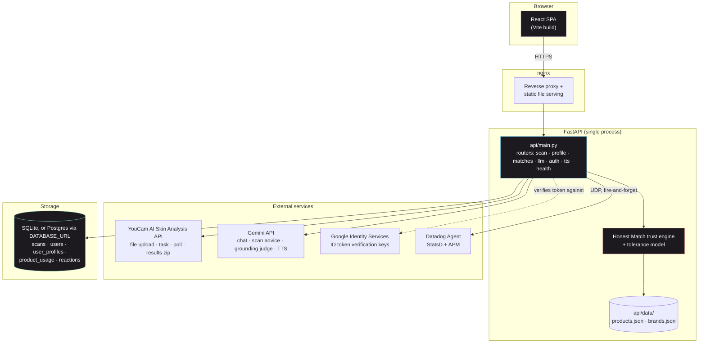
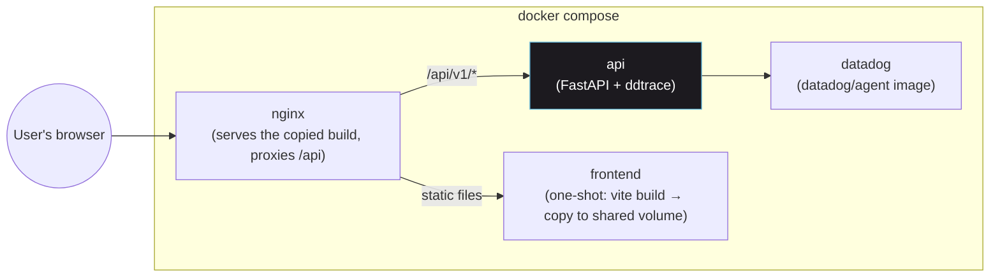
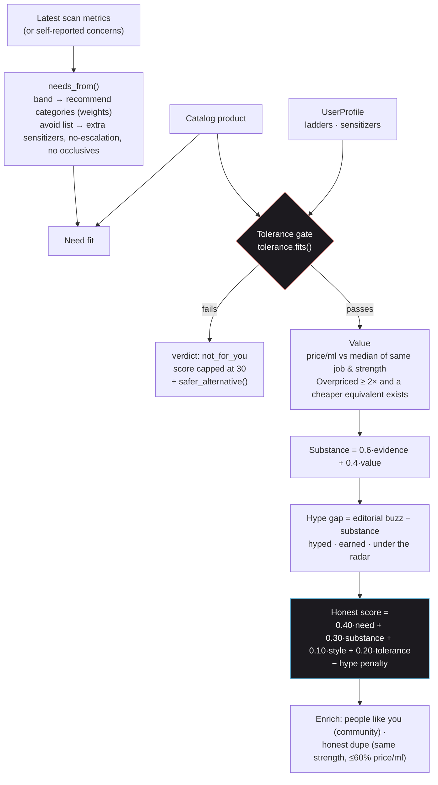
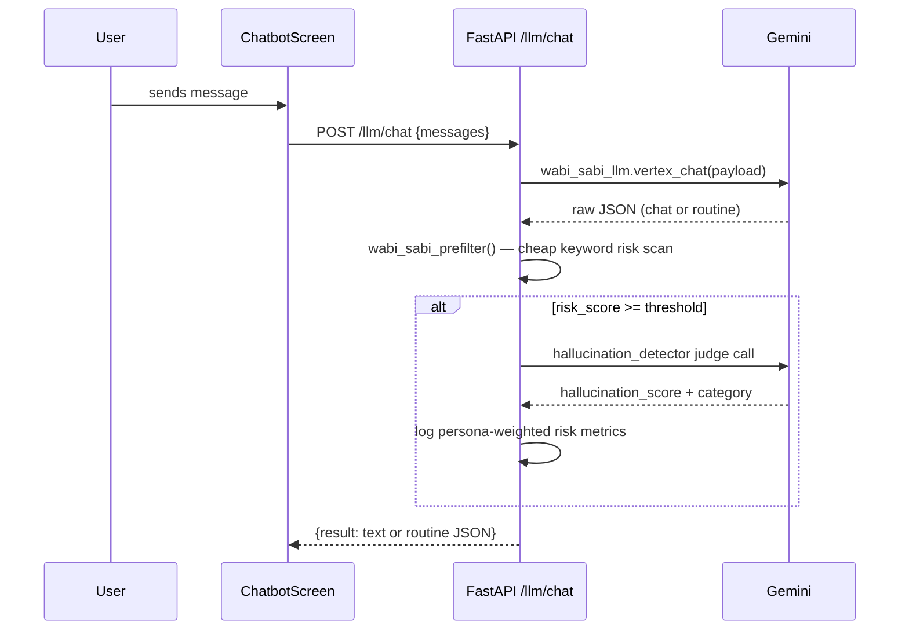
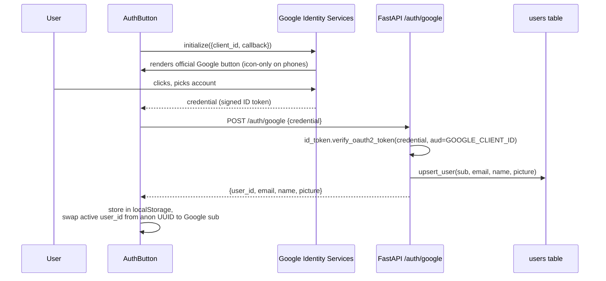
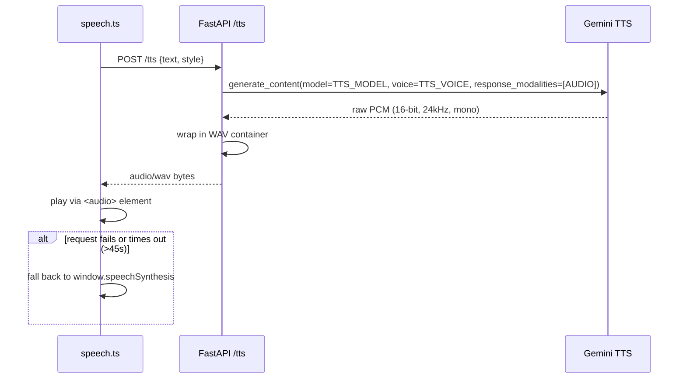
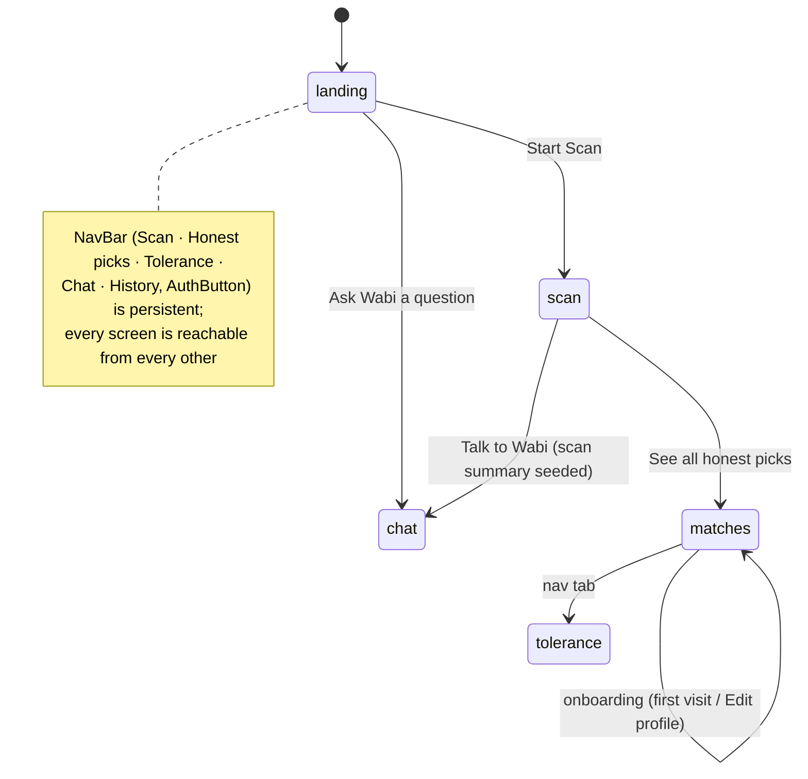
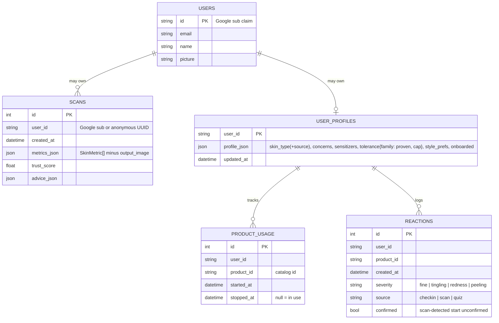

# Wabi-Sabi — Architecture

Technical deep-dive. For the product pitch see [`README.md`](README.md); for the grounding-engine design rationale see [`GROUNDING.md`](GROUNDING.md). This document assumes familiarity with both.

Wabi-Sabi is an honest skincare shopping assistant. A YouCam skin scan says what your skin needs. A personal tolerance model says what your skin can handle. A deterministic trust engine recommends only products that satisfy both, at an honest price, and tells you when something is overhyped or overpriced.

## Contents
- [System overview](#system-overview)
- [Deployment topology](#deployment-topology)
- [Backend layout](#backend-layout)
- [Frontend layout](#frontend-layout)
- [Scan flow (sequence)](#scan-flow-sequence)
- [Honest Match trust engine](#honest-match-trust-engine)
- [Tolerance model](#tolerance-model)
- [Chat flow (sequence)](#chat-flow-sequence)
- [Grounding engine internals](#grounding-engine-internals)
- [Auth flow (sequence)](#auth-flow-sequence)
- [Voice / TTS flow (sequence)](#voice--tts-flow-sequence)
- [Frontend screen state machine](#frontend-screen-state-machine)
- [Data model](#data-model)
- [API reference](#api-reference)
- [Configuration reference](#configuration-reference)
- [Known limitations / unverified assumptions](#known-limitations--unverified-assumptions)

---

## System overview



One FastAPI process and one database, with no message queue and no separate auth server. YouCam is the only external service a scan *requires*; everything else is optional or degrades gracefully:
- Datadog is optional.
- YouCam has a mock mode for offline development.
- Google Sign-In is optional (the app works anonymously).
- TTS falls back to the browser voice.
- The honest-match layer is best-effort inside a scan: if it fails, the user still gets their reading.

Product recommendations never come from an LLM. The trust engine builds every claim from the curated catalog, the scan metrics and the user's own history.

---

## Deployment topology



All four services read the **same** `env/app.env` via `env_file:` in `docker-compose*.yml`, and each ignores the variables it doesn't need. One exception: Vite's `VITE_*` variables are baked in at **build time**, before the container ever reads `env_file:`, so they must live in `frontend/.env.local` instead (see [Configuration reference](#configuration-reference)).

`frontend`'s container doesn't run a server. Its only job is `cp -a /app/. /frontend/`, which copies the Vite build output into a volume that `nginx` serves directly.

**Other ways to run it:**
- **Vercel:** `vercel.json` routes every request to `api/main.py` (60s max duration). Serverless filesystems are ephemeral, so set `DATABASE_URL` to a Postgres (e.g. Supabase) instance.
- **Local development without Docker:** run `uvicorn main:app` from `api/` and `npm run dev` in `frontend/`. Without nginx in front, routes are served at the root (e.g. `/scan`, not `/api/v1/scan`), so point the frontend at the API with `VITE_API_BASE_URL=http://localhost:<port>`.

---

## Backend layout

```
api/
├── main.py                 FastAPI app, CORS, exception handler, router mounts
├── data/
│   ├── products.json       Curated catalog: ~60 real products with actives, concentration
│   │                       (null = undisclosed), price, size, sensitizers, categories, evidence level
│   └── brands.json         Editorial brand signals: buzz tier (viral/popular/niche) + style tags
├── domain/
│   ├── advice_bands.py     Static metric band → recommend/avoid categories (11 metrics)
│   └── actives.py          Per-active strength ladders, starter rungs, sensitizer labels
├── llm/
│   ├── __init__.py         LLM wrapper around google-genai (chat + scan-advice instances)
│   ├── grounding.py        Grounding engine — see below
│   ├── prefilter.py        Chat-path keyword risk prefilter
│   └── hallucination.py    Chat-path judge-LLM scorer
├── models/                 Pydantic: llm_response (ScanResponse), profile (Product, UserProfile,
│                           HonestMatch, Reason, Dupe, …), grounding, user, hallucination
├── services/
│   ├── youcam_client.py    YouCam S2S v2: upload → task → poll → results zip → metrics,
│   │                       skin_age, overall score; infer_skin_type()
│   ├── llm_service.py      analyse_and_advise() [scan path] incl. _honest_layer(); llm_chat()
│   ├── trust_engine.py     Honest Match: needs → tolerance gate → value → hype gap →
│   │                       people like you → style → dupes / safer alternative
│   ├── tolerance.py        Pure functions: allowed_rung, fits, apply_quiz, apply_checkin,
│   │                       scan_reaction_suspects, reaction_alert
│   ├── catalog.py          Loads products.json + brands.json; rungs, value groups, medians
│   ├── profile_store.py    user_profiles, product_usage, reactions tables; cohort_reports()
│   ├── scan_store.py       scans table, shared engine (SQLite / Postgres), compute_deltas()
│   ├── auth_store.py       users table (upsert on sign-in)
│   ├── tts_service.py      Gemini TTS → WAV
│   └── user_persona_metrics.py, *_datadog_metrics.py
├── routers/                scan.py, profile.py, matches.py, llm.py, auth.py, tts.py, health.py
├── prompts/                wabi-sabi_v1/v2 (chat), wabi_sabi_scan (scan advice),
│                           hallucination_detection (chat judge), grounding_check (scan judge)
├── tests/fixtures/         skin_analysis_response.json (mock-mode YouCam payload)
└── webhooks/, datadog_agent/, utils/
```

The root path is `/api/v1` (set in `main.py`). Behind nginx, every endpoint is under that prefix, e.g. `POST /api/v1/scan`. See the [API reference](#api-reference).

---

## Frontend layout

```
frontend/src/
├── App.tsx                 Screen state machine + top-level data (auth user, chat messages)
├── components/
│   ├── NavBar.tsx           Persistent top bar: Scan / Honest picks / Tolerance / Chat / History
│   │                        (icon-only with aria-labels on phones), AuthButton
│   ├── AuthButton.tsx        Google Identity Services button (icon-only on phones) ↔ avatar/menu
│   ├── LandingScreen.tsx    Landing page with the honest-skincare pitch
│   ├── ScanScreen.tsx        Upload → results: trust line, skin score / skin age / detected type,
│   │                        YouCam masks overlaid on the photo, advice, progress,
│   │                        reaction alerts, top 3 honest picks, voice playback
│   ├── MatchesScreen.tsx    Honest picks list + Hype check search; shows onboarding first
│   ├── OnboardingScreen.tsx Skin type, concerns, sensitizers, "burned me" / "worked for me"
│   │                        product pickers, shopping-style chips
│   ├── HonestMatchCard.tsx  Score ring, reason chips, hype meter, people-like-you line,
│   │                        dupe / "try this instead", expandable "Why?" with sources
│   ├── ProductHonestModal.tsx  Full honest check for any catalog product
│   ├── ToleranceScreen.tsx  Products in use with check-in buttons + per-active ladders
│   ├── ReactionAlertCard.tsx   Confirm/dismiss a scan-detected reaction
│   ├── ChatbotScreen.tsx, ChatBubble.tsx, TypingIndicator.tsx, Routine*.tsx   (chat path)
│   ├── HistoryScreen.tsx    Scan history list + delete
│   ├── TrustLine.tsx, ProgressView.tsx
│   └── ui/                  Button, Card, Blob, SectionHeading
├── services/
│   ├── api.ts                axios client for every endpoint (VITE_API_BASE_URL override)
│   └── speech.ts             Voice controller: Gemini TTS primary, browser SpeechSynthesis fallback
├── types/google-identity.d.ts
└── entities/types.tsx        Shared TypeScript types (mirror backend Pydantic models)
```

---

## Scan flow (sequence)

```mermaid
sequenceDiagram
    participant U as User
    participant FE as ScanScreen
    participant API as FastAPI /scan
    participant YC as YouCam API
    participant G as Gemini
    participant TE as Trust engine

    U->>FE: submits/captures photo
    FE->>FE: client-side resize (long side ≤ 4096)
    FE->>API: POST /scan (multipart)
    API->>YC: POST /s2s/v2.0/file (upload URL request)
    YC-->>API: pre-signed URL + file_id
    API->>YC: PUT image bytes
    API->>YC: POST /s2s/v2.0/task/skin-analysis (11 concerns)
    YC-->>API: task_id
    loop poll (async) until success/error
        API->>YC: GET task status
    end
    YC-->>API: results.url (zip: score_info.json + per-metric mask PNGs)
    API->>API: parse ui_scores → normalise → bands; read skin_age, all.score
    API->>API: compute deltas vs previous scan
    API->>G: generate advice (metrics + allowed categories + persona)
    G-->>API: advice JSON
    API->>API: grounding (deterministic + judge, 1 retry), consistency, ambiguity, trust
    API->>API: strip failing claims, build spoken_script
    API->>TE: _honest_layer(): infer skin type, check reactions, top 3 matches
    TE-->>API: honest_matches, reaction_alerts
    API->>API: save_scan() [metrics minus output_image]
    API-->>FE: ScanResponse
    FE->>API: POST /tts (spoken_script)
    API-->>FE: WAV audio
    FE->>U: plays narration
```

**The 11 concerns:** moisture, wrinkle, redness, age_spot, acne, pore, oiliness, radiance, texture, firmness and eye_bag. YouCam returns each as a 0–100 `ui_score` where higher is healthier. `_normalise()` flips it into a 0–1 severity, and `_band_for()` buckets the severity into clear / mild / moderate / significant.

**`_honest_layer()`** (in `llm_service.py`) is best-effort. If it raises, the scan still returns without matches. It does three things:
1. Infers skin type from oiliness, moisture and redness (`youcam_client.infer_skin_type`) and saves it to the profile, unless the user set their skin type themselves.
2. If redness, texture or moisture worsened past the 0.08 noise threshold, and the user started a product with actives within the last 28 days, it logs an **unconfirmed** reaction per suspect product and returns a `ReactionAlert` for the user to confirm or dismiss.
3. Runs `trust_engine.honest_matches(limit=3)` on the new metrics.

**`ScanResponse` adds:** `skin_age`, `overall_score`, `inferred_skin_type`, `honest_matches` and `reaction_alerts`.

**`output_image`** (the annotated per-metric PNGs, base64) only ever appears in the live response and is never persisted. The frontend lays each mask over the user's photo.

---

## Honest Match trust engine

`services/trust_engine.py` scores every catalog product against one user. It is fully deterministic: no network calls and no LLM.



| Signal | Source | Notes |
|---|---|---|
| Need | YouCam bands → `ADVICE_BANDS` → product `categories` | Baseline needs (sunscreen, gentle cleansing, hydration) at low weight, so basics show up before a first scan |
| Tolerance | `tolerance.fits()` | **Hard gate.** No other signal can push a product past it |
| Value | `catalog.value_group()` medians | Active products compete with the same active; others with their category. The "Overpriced" reason only *names* an equivalent the user can use; otherwise it quotes the price alone |
| Hype gap | `brands.json` buzz tier | Editorial judgement, labelled "editorial" in the UI |
| People like you | `profile_store.cohort_reports()` | Other users with the same skin type and the same experience (new vs experienced) with the product's active; needs ≥ 3 reports, otherwise says so |
| Style | `brands.json` style tags ∩ `style_prefs` | Jaccard similarity; a 0.10-weight tiebreaker only |
| Honest dupe | `_equivalents()` | Same value group and strength rung, at least as well evidenced, fits the user; ranked by evidence → style → price |
| Try this instead | `safer_alternative()` | For products that fail the gate: the strongest same-job product the user *can* handle |

`honest_matches()` picks the best product per value group, so you get a routine rather than six retinols. `honest_check()` evaluates any single product, which is how the Hype check works. Every `Reason` carries a `source` (`youcam`, `you`, `catalog`, `editorial` or `community`) that the UI shows next to it.

---

## Tolerance model

`domain/actives.py` defines an ordered strength ladder per active family. `services/tolerance.py` holds pure functions over `UserProfile.tolerance[family] = {proven, cap}`.

| Family | Rungs (gentlest → strongest) | Starter rung |
|---|---|---|
| retinoid | HPR / ≤0.1% retinol → ≤0.3% → ≤0.5% / retinal ≤0.05% → ≤1% / retinal ≤0.1% → retinal ≤0.2% / adapalene | 0 |
| aha (glycolic-equivalent; lactic and mandelic count at half) | ≤5% → ≤8% → ≤10% → ≤15% → peel | 0 |
| bha | ≤0.5% → ≤1% → ≤2% | 1 |
| vitamin_c | derivative → L-AA ≤10% → ≤15% → >15% | 1 |
| benzoyl_peroxide | ≤2.5% → ≤5% → ≤10% | 0 |
| niacinamide | ≤5% → ≤10% → >10% | 1 |
| azelaic | ≤10% → >10% | 0 |

**Rules:**
- `allowed = proven + 1`, or the starter rung if the user has no history, capped at `cap − 1`.
- When the scan's avoid list says not to escalate (e.g. significant dryness → no retinoid escalation), `allowed = proven`.
- An undisclosed concentration is treated as the second-strongest rung. Rinse-off products sit one rung lower.

**Updates:**
- **Onboarding quiz:** "burned me" sets `cap` at that product's rung; "worked for me" sets `proven`.
- **Check-in "redness" or "peeling":** sets `cap` at the product's rung, lowers `proven` below it, and stops tracking the product.
- **Check-in "fine" after 28 or more days with no bad reaction:** proves the rung, which unlocks the next one.
- **Rescan:** produces an unconfirmed reaction. Confirming it applies the same rule as a "redness" check-in; dismissing it deletes it.

---

## Chat flow (sequence)



The chat path has no photo and no measurements, so there's nothing for grounding to check against. It keeps the prefilter → selective judge design: a cheap check first, escalating to the judge only on a risk signal.

---

## Grounding engine internals


- **`w1, w2, w3`:** the `TRUST_WEIGHTS` env var, default `0.4, 0.4, 0.2`.
- **`persona_risk_multiplier`:** the mean of `PERSONA_RISK_WEIGHTS[concern]` across the user's stated concerns.
- **Judge retry:** the judge call retries once. A dropped connection ("Server disconnected") was seen live, and a failed judge scores grounding as 0, which would otherwise report a clean reading as low-confidence.
- **Hard rule:** any claim that fails 4a, or lands a 4b violation, is removed from `advice` before the spoken script is assembled. It is never spoken with a caveat attached.

---

## Auth flow (sequence)



There's no session cookie and no server-side session store. The frontend holds `user_id` and passes it as a plain field on every scan, profile, usage, check-in and matches call. Signing in only changes *which* ID is used.

---

## Voice / TTS flow (sequence)



A ~100-word scan narration takes **about 25s** to synthesize. The 45s frontend timeout and the visible "Preparing your voice…" state are sized around that measurement.

---

## Frontend screen state machine



`App.tsx` holds a single `screen: "landing" | "scan" | "matches" | "tolerance" | "chat" | "history"` state. `AnimatePresence mode="wait"` cross-fades between screens. `MatchesScreen` shows `OnboardingScreen` until `profile.onboarded` is true.

---

## Data model



All tables share one SQLAlchemy engine (`scan_store.engine`). That's Postgres when `DATABASE_URL` is set, and otherwise a SQLite file at `SCAN_DB_PATH` (in Docker, a named volume). None of the relationships are enforced foreign keys: `user_id` is a plain string, either a Google `sub` or an anonymous client-generated UUID.

The catalog and brand signals are **not** in the database. They're static JSON in `api/data/`, loaded once and cached.

---

## API reference

All routes are under `/api/v1` behind nginx.

| Method & path | Purpose |
|---|---|
| `POST /scan` | Multipart image + `user_id` → `ScanResponse` (YouCam + advice + grounding + honest layer) |
| `GET /scan/history`, `DELETE /scan/history/{id}` | Scan history |
| `GET /profile`, `PUT /profile` | Profile + tolerance ladders view |
| `POST /profile/quiz` | Onboarding: profile fields + burned/worked product ids → updated ladders |
| `GET /catalog` | Product summaries, sensitizer options, style tags |
| `GET /matches?user_id&limit` | Honest picks for the user's latest scan (or profile concerns) |
| `GET /products/{id}/honest?user_id` | Full honest check for one product, with dupe or safer alternative |
| `GET /usage`, `POST /usage`, `DELETE /usage/{product_id}` | Products the user is tracking |
| `POST /checkin` | `{product_id, severity}` → tolerance update + message |
| `GET /reactions/pending`, `POST /reactions/{id}/resolve` | Scan-detected reactions to confirm or dismiss |
| `POST /llm/chat`, `POST /tts`, `POST /auth/google`, `GET /health` | Chat, voice, sign-in, health |

---

## Configuration reference

All variables live in one file, `env/app.env` (copy it from `env_samples/.env.samples`), and every container reads it via `env_file:`. The **exception** is `VITE_*` variables: Vite bakes them in at build time, so they must live in `frontend/.env.local`.

| Variable | Required | Purpose |
|:---|:---|:---|
| `GEMINI_API_KEY` | **Yes** | Chat, scan advice, grounding judge, TTS |
| `LLM_MODEL`, `JUDGE_MODEL`, `GROUNDING_MODEL` | Yes | Which Gemini model each role uses |
| `SYSTEM_PROMPT_PATH` | Yes | Chat system prompt file |
| `TTS_MODEL`, `TTS_VOICE` | Yes (have defaults) | Gemini TTS model and prebuilt voice |
| `TRUST_WEIGHTS` | Yes (has default) | `w1,w2,w3` for trust composition, default `0.4,0.4,0.2` |
| `YOUCAM_API_KEY` | For real scans | Required unless `YOUCAM_MOCK_MODE=true` |
| `YOUCAM_API_BASE`, `YOUCAM_TIER`, `YOUCAM_MOCK_MODE` | Have defaults | YouCam client config |
| `DATABASE_URL` | No | Postgres connection string; required on serverless hosts |
| `SCAN_DB_PATH` | Has default | SQLite file path when `DATABASE_URL` is unset |
| `GOOGLE_CLIENT_ID` | No | Backend token audience check for Sign-In |
| `VITE_GOOGLE_CLIENT_ID` | No | **`frontend/.env.local` only**: same value, build-time |
| `VITE_API_BASE_URL` | No | **Build-time**: where the frontend sends API calls (needed when running without nginx) |
| `CORS_ALLOW_ORIGINS` | Has default `*` | CORS |
| `DD_*`, `VITE_DD_*` | No | Datadog agent, APM and RUM |

---

## Known limitations / unverified assumptions

- **Catalog accuracy:** prices in `products.json` are approximate US list prices and need checking before any public claim. Concentrations come from brand disclosures; undisclosed ones are `null` and treated as strong.
- **Editorial buzz:** the buzz tiers in `brands.json` are a hand-labelled judgement, not a measurement. The UI labels them "editorial".
- **Cold start for "people like you":** the cohort signal needs at least 3 matching reports. Until the app has users, it honestly says there isn't enough data.
- **Concern mapping:** the five newer concerns (oiliness, radiance, texture, firmness, eye_bag) use the same higher-is-healthier `ui_score` polarity as the original six. This matches the live responses seen so far, but the advice-band mappings for them are our own clinical judgement.
- **YouCam usage cost:** 11 concerns per scan may cost more units than 6; this hasn't been measured.
- **Skin type inference:** a heuristic over three metrics, not a dermatological classification. A user's self-reported skin type always wins.
- **Grounding judge:** depends on a Gemini call. If both attempts fail, grounding counts as 0 and confidence drops to "uncertain" or lower.
- **Mock fixture:** in `api/tests/fixtures/skin_analysis_response.json`, the original six metrics, skin age and overall score are real captured values. The five newer concern values are illustrative.
- **Local dev routing:** without nginx, routes aren't under `/api/v1`; set `VITE_API_BASE_URL` accordingly.
