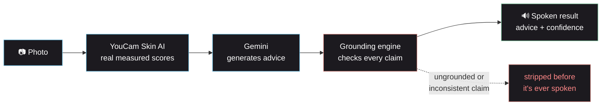
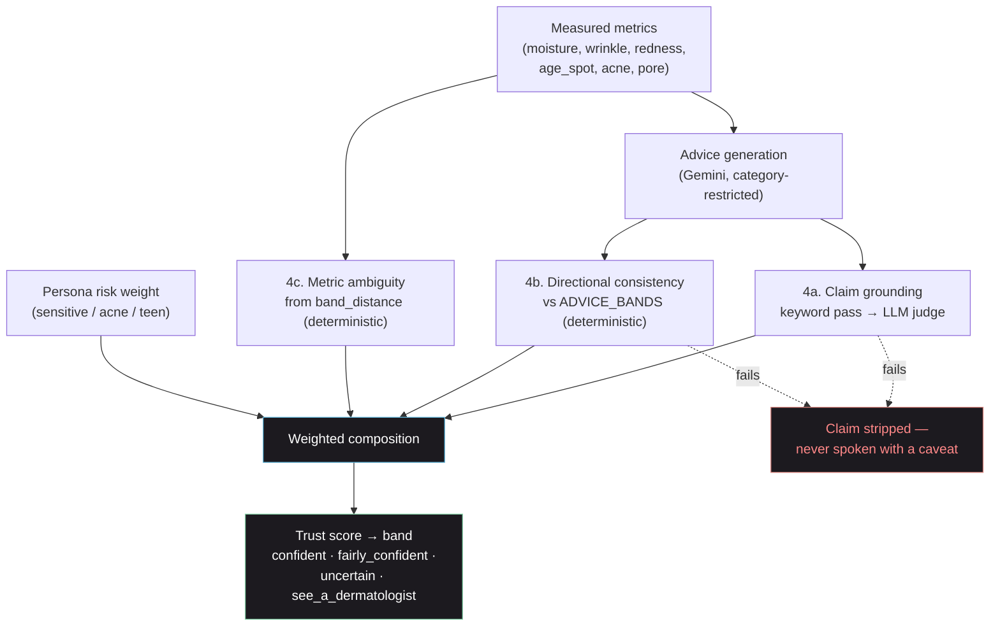

<h1 align="center">Wabi-Sabi</h1>

<p align="center">
  <strong>A voice-first skin AI assistant that shows its work</strong>
</p>

<p align="center">
  <em>Instead of an AI that just sounds confident, Wabi-Sabi measures your skin,<br/>checks every piece of advice against those measurements, and tells you exactly how sure it is — out loud.</em>
</p>

<p align="center">
  
  
  
  
  
</p>

<p align="center">
  <a href="#the-problem">The Problem</a> ·
  <a href="#how-it-works">How It Works</a> ·
  <a href="#features">Features</a> ·
  <a href="#tech-stack">Tech Stack</a> ·
  <a href="#the-grounding-engine">Grounding Engine</a> ·
  <a href="#quick-start">Quick Start</a> ·
  <a href="#resilience--fallbacks">Resilience</a>
</p>

---

## The Problem

Skincare advice from a generic AI chatbot has a specific failure mode: it sounds exactly as confident when it's right as when it's making something up. Ask a chatbot "does this help my dryness?" and it will answer fluently either way — there's nothing underneath the sentence to check.

That's a real-world harm vector, not an abstract one. Skincare advice affects real skin. A hallucinated ingredient interaction, an overstated claim, or advice with no relationship to the user's actual skin condition can cause irritation, wasted money, or — worse — delay someone from seeing a dermatologist when they should.

Most AI observability treats this as a text-quality problem: score how "hallucinated" a response *sounds*, evaluate a sample of prompts, move on. That's a reasonable stopgap when text is the only input available. Wabi-Sabi starts from a different premise: **once you have a photo, you have something to check advice against.**

## How It Works



1. **Scan** — take a photo. It's sent to YouCam Skin AI, which returns real numeric scores (moisture, wrinkle, redness, age spots, acne, pore visibility) plus an annotated visualisation image per metric.
2. **Advice generation** — Gemini turns the measured scores into warm, friend-toned spoken advice, restricted to ingredient/property categories (never brand names) drawn from a static, auditable lookup table — not invented by the model.
3. **Grounding check** — before anything is spoken, every claim is checked: does it trace to a measured metric? Is it consistent with the severity band? Is the underlying measurement itself borderline/ambiguous? Anything that fails is stripped, not softened with a caveat.
4. **Spoken result** — the reading, the (already-verified) advice, a progress note if you've scanned before, and a trust line stating exactly how confident the result is — all spoken aloud, usable with the screen off.

See [`GROUNDING.md`](GROUNDING.md) for the full reasoning on why this is grounding rather than hallucination *detection*, and [`ARCHITECTURE.md`](ARCHITECTURE.md) for the complete technical breakdown.

---

## Features

### Voice-first skin scan
- Real skin measurements via the YouCam Skin AI API (not simulated) — moisture, wrinkle, redness, age spots, acne, pore visibility
- Every result is spoken via Gemini TTS (with automatic browser-voice fallback) — the primary output is `spoken_script`, not the visual layer
- Per-metric annotated analysis images displayed alongside your submitted photo
- Progress tracking between scans, with a significance threshold so measurement noise is never reported as "improvement"

### The grounding engine
- **Claim grounding** — a cheap deterministic keyword pass catches absolute/unsupported language for free; anything that survives goes to one LLM judge call that checks each claim against the measured metrics
- **Directional consistency** — fully deterministic (no LLM): recommending something on the *avoid* list for the measured severity band is a hard failure
- **Metric ambiguity** — a reading sitting near a band boundary is genuinely uncertain, regardless of how well the advice is worded, and lowers confidence accordingly
- **Persona-weighted trust score** — the same measured severity yields a lower stated confidence and an earlier dermatologist referral for higher-risk personas (sensitive skin, acne, teen age bucket)
- **Hard rule**: a failing claim is stripped before it's spoken — never voiced with a low-confidence caveat attached

### Chat handoff
- A secondary text-chat assistant (the original product surface) for open-ended skincare questions and routine generation
- One tap ("Talk to Wabi, the skincare assistant!") takes a completed scan straight into a chat, pre-seeded with the full result as context

### Accounts are optional
- Fully usable anonymously — a local random ID is all that's needed to scan and see history
- Optional Google Sign-In (real ID-token verification server-side, not just client-side decoding) for history that follows you across devices — no client secret involved, no separate account system beyond that

### Scan history
- Every scan is saved (metrics, trust score, advice — not the annotated images, to keep the store lean) and browsable from the History tab
- Delete any scan, scoped so one user can never delete another's

### Observability
- Datadog metrics across both the chat and scan paths — request volume, grounding scores, consistency violations, trust-band distribution, YouCam task latency/failures, voice playback events
- The original chat path's selective-hallucination-evaluation and persona-risk-weighting design is untouched and still running

---

## Tech Stack

### Frontend
| Technology | Purpose |
|:---|:---|
| **React 19 + Vite** | UI, fast dev/build |
| **TypeScript** | End-to-end type safety |
| **Tailwind CSS** | Utility-first styling, dark theme, custom design tokens |
| **Framer Motion** | Scroll-reveal, screen transitions, reduced-motion aware |
| **Web Speech API + `<audio>`** | Voice playback (Gemini TTS primary, browser voice fallback) |
| **Google Identity Services** | Sign-in button + ID token issuance |

### Backend
| Technology | Purpose |
|:---|:---|
| **FastAPI** | Request orchestration, all routing |
| **Gemini API** (`google-genai`) | Chat generation, scan-advice generation, grounding judge calls, text-to-speech |
| **YouCam Skin AI API** | Real skin measurement (file upload → task → poll → results) |
| **SQLAlchemy + SQLite** | Scan history, user records — single file, no external DB |
| **google-auth** | Server-side Google ID token verification |
| **Datadog** (`datadog`, `ddtrace`) | Metrics, APM tracing |
| **Docker Compose + Nginx** | Orchestration and reverse proxy |

---

## The Grounding Engine



Full writeup: [`GROUNDING.md`](GROUNDING.md). Implementation: `api/llm/grounding.py`, `api/domain/advice_bands.py`.

---

## Data & Privacy

- **No account required.** Scanning and viewing history work with a local, randomly generated ID stored only in the browser.
- **Sign-in is optional and stateless-by-design.** Google Sign-In uses the Identity Services ID-token flow — the backend verifies the token's signature directly against Google's public keys (`google-auth`), no authorization-code exchange, no client secret, no third-party auth provider in the loop.
- **One SQLite file**, two tables: `scans` (metrics, trust score, advice — text only) and `users` (id = Google `sub`, email, name, picture). Annotated analysis images are never persisted — they exist only in the live response for the scan you just took.
- **Mock mode.** `YOUCAM_MOCK_MODE=true` runs the entire pipeline — advice generation, grounding, trust scoring — against a fixture built from a real captured response, so the app is fully testable without spending YouCam's limited free-tier units.

---

## Project Structure

```
wabi-sabi/
├── api/                          FastAPI backend
│   ├── main.py                   App entry, router mounts
│   ├── llm/
│   │   ├── __init__.py           Gemini client wrapper (chat + scan LLM instances)
│   │   ├── grounding.py          The grounding engine (scan path)
│   │   ├── prefilter.py          Keyword risk prefilter (chat path, unchanged)
│   │   └── hallucination.py      Judge-LLM hallucination scorer (chat path, unchanged)
│   ├── domain/
│   │   └── advice_bands.py       Static metric-band → advice-category lookup
│   ├── models/                   Pydantic models (llm_response, grounding, user, hallucination)
│   ├── services/
│   │   ├── llm_service.py        Orchestration: llm_chat() + analyse_and_advise()
│   │   ├── youcam_client.py      YouCam Skin AI client (upload/task/poll/parse)
│   │   ├── scan_store.py         SQLite scan history (save/get/delete/deltas)
│   │   ├── auth_store.py         SQLite users table
│   │   ├── tts_service.py        Gemini TTS → WAV
│   │   ├── user_persona_metrics.py
│   │   └── llm_datadog_metrics.py
│   ├── routers/                  llm.py, scan.py, auth.py, tts.py, health.py
│   ├── prompts/                  System prompts (chat, scan, grounding judge, hallucination judge)
│   └── webhooks/, datadog_agent/, utils/
├── frontend/                     React + Vite
│   └── src/
│       ├── App.tsx                Screen state machine (landing/scan/chat/history)
│       ├── components/
│       │   ├── LandingScreen.tsx  Full-screen-per-section descriptive landing page
│       │   ├── ScanScreen.tsx     Capture → results → voice playback → chat handoff
│       │   ├── ChatbotScreen.tsx, ChatBubble.tsx, RoutineDisplay*.tsx
│       │   ├── HistoryScreen.tsx  Scan history + delete
│       │   ├── TrustLine.tsx, ProgressView.tsx   Icon+text confidence/delta display
│       │   ├── NavBar.tsx, AuthButton.tsx        Nav + Google Sign-In
│       │   └── ui/                Shared Button/Card/Blob/SectionHeading primitives
│       └── services/              api.ts (backend client), speech.ts (voice playback)
├── tests/                        pytest suite (mock-mode, no real credentials needed)
├── nginx/, scripts/, docker-compose*.yml
├── env_samples/.env.samples      Copy to env/app.env
├── GROUNDING.md                  Why grounding, not hallucination detection
└── ARCHITECTURE.md               Full technical deep-dive + diagrams
```

---

## Quick Start

### Prerequisites
- Docker + Docker Compose
- A [Google AI Studio](https://aistudio.google.com) API key (free tier) — required
- A [YouCam / Perfect Corp](https://yce.perfectcorp.com) API key — optional, leave `YOUCAM_MOCK_MODE=true` without one
- A [Google Cloud OAuth Client ID](https://console.cloud.google.com) — optional, only for Sign-In

### 1. Configure environment
```bash
mkdir env
cp env_samples/.env.samples env/app.env
# fill in GEMINI_API_KEY at minimum
```

### 2. (Optional) Enable Google Sign-In
```bash
echo "VITE_GOOGLE_CLIENT_ID=<same client id as GOOGLE_CLIENT_ID in env/app.env>" > frontend/.env.local
```

### 3. Run
```bash
docker compose -f docker-compose-local.yml up -d --build
```

Open **http://localhost:8001**.

### Run tests
```bash
python -m pytest tests/
```
All 33 tests run against `YOUCAM_MOCK_MODE=true` with mocked LLM calls — no real credentials needed.

---

## Resilience & Fallbacks

| Layer | Condition | Fallback |
|:---|:---|:---|
| **Voice** | Gemini TTS fails or times out | Automatic switch to the browser's built-in `SpeechSynthesis` |
| **YouCam network calls** | Transient connection error | Retried automatically (short backoff, up to 3 attempts) |
| **YouCam image spec** | Under-spec / rejected image | Client-fixable error surfaced directly, not a generic failure |
| **Grounding judge** | Malformed JSON from the LLM | Safe fallback result (fails closed — treated as ungrounded, not silently passed) |
| **Google Sign-In** | Not configured | Backend returns a clean `503`; frontend shows "Sign-in unavailable" instead of a broken button — app stays fully usable anonymously |
| **Datadog** | Agent unreachable | Fire-and-forget UDP metrics; app never blocks on it |

---

---

## Hackathon

Built for the **YouCam API Skin AI Hackathon**. MIT-licensed foundation (see `LICENSE`), adapted and substantially rebuilt from a text-chatbot base into a grounded, voice-first photo-scan product.
