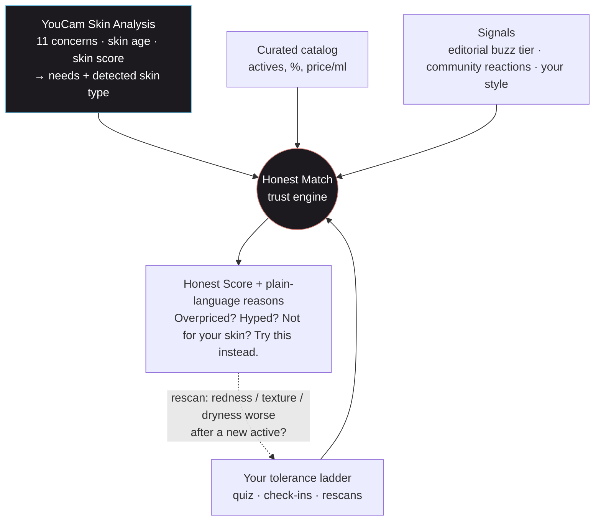
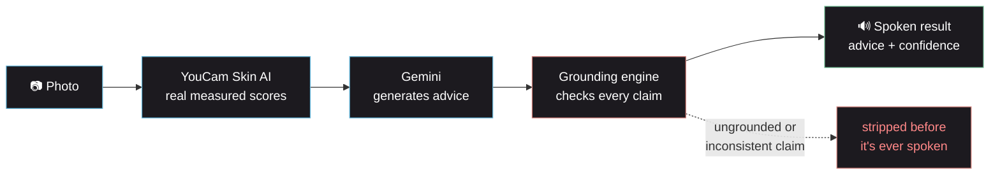
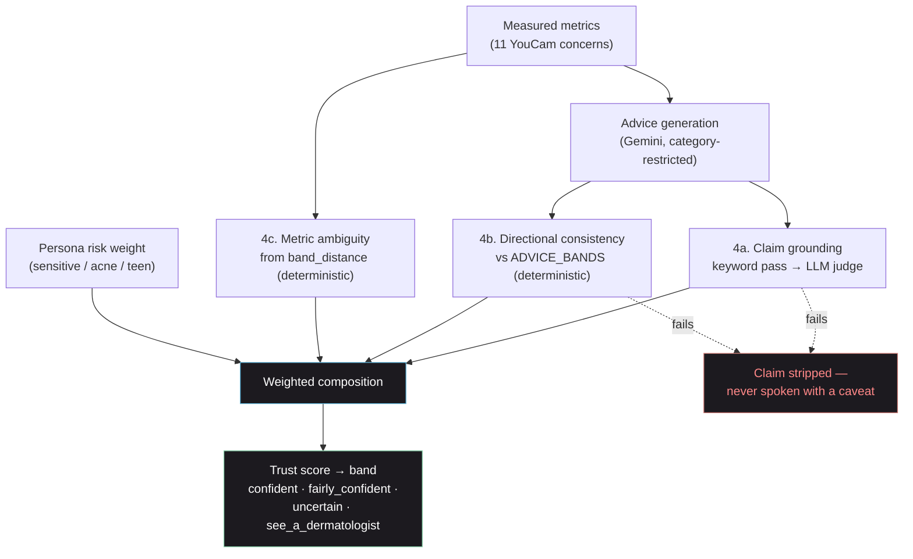

<h1 align="center">Wabi-Sabi</h1>

<p align="center">
  <strong>Honest skincare shopping: measured by YouCam, fit to your tolerance, no hype</strong>
</p>

<p align="center">
  <em>What worked for someone else isn't evidence it'll work for you. Wabi-Sabi measures your skin with YouCam,<br/>remembers what your skin can tolerate, and only recommends products that actually help you, at an honest price.</em>
</p>

<p align="center">
  <a href="https://frontend-two-blush-t4kahgjhky.vercel.app"><strong>Live demo</strong></a>
</p>

<p align="center">
  
  
  
  
  
</p>

<p align="center">
  <a href="#features">Features</a> ·
  <a href="#how-we-use-the-youcam-api">YouCam API</a> ·
  <a href="#the-buzz-meter-hype-gap">Buzz meter</a> ·
  <a href="#how-it-works">How It Works</a> ·
  <a href="#tech-stack">Tech Stack</a> ·
  <a href="#the-grounding-engine">Grounding Engine</a> ·
  <a href="#quick-start">Quick Start</a> ·
  <a href="#resilience--fallbacks">Resilience</a>
</p>

---

## Honest Match: the trust engine

Influencer marketing makes hype cheap. A serum goes viral, everyone buys it, and people with sensitive skin burn their faces on a 1% retinol they were never ready for. **Something that worked for someone else is not evidence that it'll work for you.**

Wabi-Sabi is an honest skincare shopping assistant. It only recommends products that:
1. **do what your skin actually needs**, measured by a YouCam scan, not guessed;
2. **sit within your personal tolerance**, a per-active ladder (retinoids, AHAs, BHAs, vitamin C, benzoyl peroxide…) learned from your history, your check-ins and your repeat YouCam scans;
3. **are honestly priced**, comparing price per ml with products doing the same job at the same strength;
4. **are worth more than their hype.**



| Signal | Source | What the user sees |
|---|---|---|
| **Need** | YouCam scan bands → advice categories | "Provides a gradual retinoid, which your fine lines (moderate) reading calls for." |
| **Tolerance** (hard gate) | Your ladder, from the quiz, check-ins and rescans | "You've reacted to this strength before, so it's off your list." |
| **Value** | Catalog price per ml vs same job, same strength | "Overpriced: $6.07/ml, 4.7× typical. Maelove Glow Maker does the same at $1.07/ml." |
| **Hype gap** | Editorial buzz tier (`api/data/brands.json`, labelled editorial in the UI) vs substance (evidence + value) | "La Mer is a viral-buzz brand, but this product's evidence and value score only 17/100." |
| **People like you?** | This app's own check-ins, from users with the same skin type and the same experience with that active | "2 of 3 people with oily skin who are new to vitamin C reported redness or peeling on this." |
| **Your style** | Style tags (budget, derm, clean, k-beauty, luxury, pharmacy) | A tiebreaker between equally honest options, never a reason to recommend something weaker. |
| **Honest dupe / Try this instead** | Catalog + your ladder | "Same job (hydration), 99% less per ml: Vanicream Moisturizing Cream", or, if it's too strong for you, "A version your skin can handle: Retinol 0.5%". |

Every reason is assembled from structured facts. No LLM writes claims about products.

### The buzz meter (hype gap)

Every product card has a **hype meter**: one track with two markers.

```
Hype meter                                   More hype than substance
├──●━━━━━━━━━━━━━━━━━━━━━━━━━━━━━━━━━━━━━━━━━━━━━━━━━━━━━━━━━━━━━━━━●──┤
   substance (0.17)                                        buzz (0.95)
```

- **Coral marker, buzz:** how heavily the *brand* is marketed and talked about on social media. Each brand has a hand-labelled tier in [`api/data/brands.json`](api/data/brands.json): `viral` = 0.95, `popular` = 0.75, `niche` = 0.4. It is an editorial judgement, not a measurement, so the UI labels it **"Buzz (editorial)"**.
- **Green marker, substance:** what's actually in the bottle, computed from the catalog:

  ```
  substance = 0.6 × evidence + 0.4 × value
  evidence  = strong 1.0 · moderate 0.6 · weak 0.25   (× 0.8 if the brand hides the concentration)
  value     = min(1, typical price per ml for the same job & strength ÷ this product's price per ml)
  ```
- **The gap between them is the hype gap** (`buzz − substance`), and it sets the label:

| Gap | Label | Meaning |
|---|---|---|
| > +0.25 | **More hype than substance** | The marketing is ahead of the formula or the price. Shown in red, and the Honest Score is docked `0.5 × (gap − 0.25)` (about 26 points for La Mer). |
| −0.25 to +0.25 | **Buzz is earned** | Popularity roughly matches what you get. If it's still overpriced, it reads **"Formula earns it, price doesn't"**. |
| < −0.25 | **Under the radar** | Better than its buzz suggests, typically a niche brand with a proven active at a fair price. |

Example: **La Mer Crème de la Mer** is a viral-buzz brand (0.95), but weak evidence for its key ingredient and $6.67/ml (22.7× the typical price for hydration) give it a substance of 0.17. The card reads *"La Mer is a viral-buzz brand, but this product's evidence and value score only 17/100"*, and it offers an honest dupe.

The meter only ever *lowers* a score for unearned hype. Being popular never raises a product's score, and buzz can never get a product past your tolerance gate. Implementation: `hype_info()` and `substance()` in [`api/services/trust_engine.py`](api/services/trust_engine.py), and `HypeMeter` in [`frontend/src/components/HonestMatchCard.tsx`](frontend/src/components/HonestMatchCard.tsx).

## How we use the YouCam API

Everything starts from **YouCam AI Skin Analysis** (S2S API v2), called server-side in [api/services/youcam_client.py](api/services/youcam_client.py):

1. `POST /s2s/v2.0/file` → a file id and a pre-signed upload request; the image is PUT exactly as instructed.
2. `POST /s2s/v2.0/task/skin-analysis` with `src_file_id` and **11 concerns**: moisture, wrinkle, redness, age_spot, acne, pore, oiliness, radiance, texture, firmness, eye_bag.
3. `GET /s2s/v2.0/task/skin-analysis/{task_id}` polled (non-blocking) until `success`.
4. The result zip is downloaded and parsed: `score_info.json` gives a `ui_score` per concern, plus `skin_age` and the composite `all.score`; the annotated mask PNG for each concern is shown in the app.

What the app does with that data:
- **Needs:** each concern's `ui_score` is normalised to a severity band (clear / mild / moderate / significant), and each band maps to ingredient categories to recommend and avoid ([api/domain/advice_bands.py](api/domain/advice_bands.py)). The categories drive which products count as "what your skin needs".
- **Skin type detection:** oiliness, moisture and redness classify skin as oily, dry, combination, normal or sensitive. This feeds the tolerance model and the "people like you" cohort, without relying on self-report.
- **Safety constraints:** the avoid lists become filters. For example, moderate redness rules out fragranced products, and significant dryness blocks any retinoid escalation.
- **Scan-verified tolerance:** on every rescan, a measurable worsening in redness, texture or moisture after starting an active raises an alert ("Your redness reading got worse since you started X. Was it irritating your skin?"). Confirming it lowers that active's ladder.
- **Progress:** scan-to-scan deltas count only if they exceed a noise threshold, so the app never overstates improvement.
- **Grounded advice:** Gemini voices the advice, and every claim is checked against the measured metrics before it's spoken (see the grounding engine below).


---

## The Problem

Skincare advice from a generic AI chatbot has a specific failure mode: it sounds exactly as confident when it's right as when it's making something up. Ask a chatbot "does this help my dryness?" and it will answer fluently either way — there's nothing underneath the sentence to check.

That's a real-world harm vector, not an abstract one. Skincare advice affects real skin. A hallucinated ingredient interaction, an overstated claim, or advice with no relationship to the user's actual skin condition can cause irritation, wasted money, or — worse — delay someone from seeing a dermatologist when they should.

Most AI observability treats this as a text-quality problem: score how "hallucinated" a response *sounds*, evaluate a sample of prompts, move on. That's a reasonable stopgap when text is the only input available. Wabi-Sabi starts from a different premise: **once you have a photo, you have something to check advice against.**

## How It Works



1. **Scan** — take a photo. It's sent to YouCam Skin AI, which returns real numeric scores for 11 concerns (moisture, wrinkle, redness, age spots, acne, pores, oiliness, radiance, texture, firmness, eye bags), a skin age, an overall skin score, and an annotated visualisation image per metric.
2. **Advice generation** — Gemini turns the measured scores into warm, friend-toned spoken advice, restricted to ingredient/property categories drawn from a static, auditable lookup table — not invented by the model. Product names never come from the LLM: specific products are only ever recommended by the deterministic Honest Match engine, from the curated catalog.
3. **Grounding check** — before anything is spoken, every claim is checked: does it trace to a measured metric? Is it consistent with the severity band? Is the underlying measurement itself borderline/ambiguous? Anything that fails is stripped, not softened with a caveat.
4. **Spoken result** — the reading, the (already-verified) advice, a progress note if you've scanned before, and a trust line stating exactly how confident the result is — all spoken aloud, usable with the screen off.
5. **Honest picks** — the same scan feeds the Honest Match engine: the top products for your needs, within your tolerance, at an honest price, plus an alert if a reading got worse since you started a new active.

See [`GROUNDING.md`](GROUNDING.md) for the full reasoning on why this is grounding rather than hallucination *detection*, and [`ARCHITECTURE.md`](ARCHITECTURE.md) for the complete technical breakdown.

---

## Features

**Try it live:** https://frontend-two-blush-t4kahgjhky.vercel.app

### At a glance

| Where | What you do | What you get |
|---|---|---|
| **Honest picks → onboarding** | Tell it what burned your skin, what worked, what you react to | A personal tolerance ladder for every active ingredient |
| **Scan** | Upload a selfie | 11 YouCam skin readings, skin age, skin score, detected skin type, and the masks drawn on your face |
| **Scan → honest picks** | Nothing, it's automatic | Your top 3 products for *this* reading, within your tolerance, at an honest price |
| **Honest picks** | Browse | A routine (one pick per job), each with an Honest Score and a "Why?" |
| **Hype check** | Search any product you saw online | The verdict *for your skin*: fits or not, overpriced or not, hype or substance, plus a cheaper or safer alternative |
| **Tolerance** | Tap how your skin reacted | Your ladder climbs or caps itself; products that hurt you never come back |
| **Rescan** | Scan again later | An alert if redness, texture or dryness got worse since you started something new |
| **Chat / History** | Ask questions, review past scans | A skincare assistant seeded with your scan, and your progress over time |

---

### 1. A real skin reading from YouCam

You upload a selfie and YouCam AI Skin Analysis measures **11 concerns**: moisture, wrinkles, redness, dark spots, acne, pores, oiliness, radiance, texture, firmness and eye bags. It also returns a **skin age** and an **overall skin score**.

- **Each reading becomes a band:** clear, mild, moderate or significant. The bands decide what your skin needs (e.g. "pores: mild" calls for oil control and pore care) and what to avoid (e.g. "redness: moderate" rules out fragranced products).
- **Your skin type is detected from the scan** (oily, dry, combination, normal or sensitive, from oiliness, moisture and redness), so you don't have to guess. If you set it yourself, your choice wins.
- **YouCam's analysis masks are laid over your own photo**, each labelled like *"Pore · Mild · 66/100"*, so you can see exactly where each reading comes from.
- **The result is spoken aloud**, so you can use it with the screen off. Every sentence is checked against the measurements before it's voiced (see [The grounding engine](#the-grounding-engine)).

### 2. Onboarding: your skin's history, not an influencer's

The first visit to **Honest picks** asks a few quick questions:
- **Ingredients your skin reacts to** (fragrance, essential oils, drying alcohol, lanolin, coconut-derived oils). Any product containing one is a hard no, however good it looks.
- **Products that burned, stung or peeled your skin.** Search the catalog and pick them. Nothing at that strength is ever suggested again.
- **Actives you've used happily for a month or more.** These prove what you tolerate, so the app can suggest the *next* careful step.
- **What you want to work on**, used until your first scan, and your **shopping style** (budget, derm, clean, k-beauty, luxury, pharmacy), used only to break ties.

### 3. Tolerance ladders: one careful step at a time

Every active ingredient has a ladder from gentlest to strongest. For retinoids that's HPR → 0.3% retinol → 0.5% → 1% / retinal 0.1% → strong retinal / adapalene. Similar ladders cover AHAs, BHAs, vitamin C, benzoyl peroxide, niacinamide and azelaic acid.

- **You can only go one rung above what you've proven.** New to an active? You start at the bottom rung, or one rung up for gentler actives like vitamin C, BHA and niacinamide (e.g. L-ascorbic acid up to 10%).
- **A rung that irritated you becomes a hard cap.** Nothing at or above it is recommended again.
- **The brand doesn't say how strong it is?** Then the app treats it as strong. Hiding the number isn't rewarded.
- **The Tolerance screen** shows every ladder, colour-coded with text labels (proven, safe next step, locked, irritated you), so it doesn't rely on colour alone.

### 4. Check-ins and rescans: it keeps learning

- **"I'm using this"** on any pick starts tracking it.
- **Check-ins** have four buttons: *All good, Tingling, Redness, Peeling.*
  - **Redness or peeling** caps that strength immediately and stops tracking the product.
  - **Tingling** gets practical advice (go to 2-3 nights a week).
  - **28 days of "All good"** proves the rung and unlocks the next one.
- **Rescans catch what you might miss.** If redness, texture or dryness gets measurably worse (beyond a noise threshold) after you started a new active, the app asks: *"Your redness reading got worse since you started The Ordinary Retinol 0.5%. Was it irritating your skin?"* You confirm or dismiss it; the scan alone never changes your ladder.

### 5. Honest picks and the Honest Score

Your picks are a **routine, not a list of six retinols**: the best product for each job your skin needs (sun protection, cleansing, hydration, a retinoid…). Every card shows:
- **An Honest Score (0–100)**, which weighs what your skin needs (40%), substance, meaning evidence plus value (30%), how comfortably it fits your tolerance (20%) and your style (10%). Unearned hype subtracts from it.
- **Chips:** *Your skin needs this · Fits your tolerance · Great value / Fair price / Overpriced*.
- **A "Why?" panel** listing every reason with its source: *YouCam scan, You, Ingredients & price, Editorial buzz rating* or *People like you*. Nothing is a black box.
- **"I'm using this"** to start tracking it.

**Honest picks never include a product the app itself flags as overpriced or as more hype than substance.** Those are still easy to look up through Hype check.

### 6. Hype check: is it worth it *for you*?

Saw something on your feed? Search it and get the full honest check, whether or not it's in your picks:

> **Drunk Elephant A-Passioni (1% retinol)** for someone the 1% retinol burned:
> - *Not for your skin:* "You've reacted to this strength before, so it's off your list."
> - *Overpriced:* "$2.47/ml, 2.5× the typical price for this job."
> - *Formula earns it, price doesn't:* the buzz is backed by a proven formula, but you pay a brand premium.
> - **Try this instead:** "The Ordinary Retinol 0.5% in Squalane", the next safe step on *your* ladder, at $0.26/ml.

### 7. The buzz meter

Every card has a hype meter: **buzz** (how heavily the brand is marketed, an editorial tier) against **substance** (evidence plus value). A big gap reads *"More hype than substance"* and lowers the score; popularity never raises it. Full explanation in [The buzz meter](#the-buzz-meter-hype-gap).

> **La Mer Crème de la Mer**: viral buzz (0.95) against substance 0.17, at $6.67/ml (22.7× the typical price for hydration). *"More hype than substance"*, and an **honest dupe: Vanicream Moisturizing Cream, 99% less per ml.**

### 8. Honest dupes and "try this instead"

- **Honest dupe:** the same job at the same strength, at least as well evidenced, for at most 60% of the price per ml, and only if it fits *your* tolerance.
- **Try this instead:** when a product is too strong for you, the strongest version of the same job that you *can* handle.
- **Products are only named when you can use them.** The app never points you to a cheaper product that would also hurt you; in that case it just quotes the cheaper price.

### 9. People like you

Instead of "it worked for her", the app shows what **other Wabi-Sabi users with your skin type and the same experience with that active** actually logged, e.g. *"2 of 3 people with oily skin who are new to vitamin C reported redness or peeling on this."* It needs at least 3 matching reports; until then it says so instead of guessing. Only counts are ever shown, never who reported what.

### 10. Grounded, voice-first advice

- **Gemini writes the scan advice, but it can only use ingredient categories allowed for your measured bands.**
- **Every claim is checked before it's spoken:**
  - a keyword pass for absolute or medical language;
  - a judge call checking each claim against the metrics;
  - a deterministic consistency check against the "avoid" lists;
  - an ambiguity score for readings near a band edge.
- **Claims that fail are removed, not softened.** A trust line says how confident the reading is, from "confident" to "see a dermatologist".
- **Product claims never come from the LLM.** They're built from the catalog and your data.

### 11. Chat, history and accounts

- **Chat:** one tap hands a finished scan to the skincare assistant, already filled in with your results.
- **History:** every scan's readings and advice, deletable; the annotated images are never stored.
- **No account needed:** an anonymous ID works for everything. Optional Google Sign-In (verified server-side) keeps your history across devices.
- **Works on phones:** icon-only navigation with screen-reader labels, and no sideways scrolling.

### 12. Built to fail safely

- **If the shopping layer fails, the scan still returns** its reading and advice.
- **The grounding judge retries a dropped connection once.**
- **Voice falls back** to the browser's own speech.
- **YouCam has a mock mode** for offline development, built from a real captured response.

See [Resilience & Fallbacks](#resilience--fallbacks).

---

## Tech Stack

### Frontend
| Technology | Purpose |
|:---|:---|
| **React 19 + Vite** | UI, fast dev/build |
| **TypeScript** | End-to-end type safety |
| **Tailwind CSS** | Utility-first styling, dark theme, custom design tokens |
| **Framer Motion** | Scroll-reveal, screen transitions, reduced-motion aware |
| **Web Speech API + `<audio>`** | Voice playback (Gemini TTS primary, browser voice fallback) |
| **Google Identity Services** | Sign-in button + ID token issuance |

### Backend
| Technology | Purpose |
|:---|:---|
| **FastAPI** | Request orchestration, all routing |
| **Gemini API** (`google-genai`) | Chat generation, scan-advice generation, grounding judge calls, text-to-speech |
| **YouCam Skin AI API** | Real skin measurement (file upload → task → poll → results), 11 concerns |
| **SQLAlchemy + SQLite / Postgres** | Scans, users, profiles, product usage, reactions — SQLite locally, Postgres via `DATABASE_URL` |
| **Honest Match engine** (`trust_engine.py`) | Deterministic product scoring over a curated catalog (`api/data/`) |
| **google-auth** | Server-side Google ID token verification |
| **Datadog** (`datadog`, `ddtrace`) | Metrics, APM tracing |
| **Docker Compose + Nginx** | Local / self-hosted orchestration and reverse proxy |
| **Vercel** | Production hosting: FastAPI as a Python serverless function, React as a static build |
| **pytest** | 61 tests, all runnable without real API keys |

---

## The Grounding Engine



Full writeup: [`GROUNDING.md`](GROUNDING.md). Implementation: `api/llm/grounding.py`, `api/domain/advice_bands.py`.

---

## Data & Privacy

- **No account required.** Scanning and viewing history work with a local, randomly generated ID stored only in the browser.
- **Sign-in is optional and stateless-by-design.** Google Sign-In uses the Identity Services ID-token flow — the backend verifies the token's signature directly against Google's public keys (`google-auth`), no authorization-code exchange, no client secret, no third-party auth provider in the loop.
- **One database** (SQLite file, or Postgres via `DATABASE_URL`), five tables: `scans` (metrics, trust score, advice — text only), `users` (id = Google `sub`, email, name, picture), `user_profiles` (skin type, sensitizers, tolerance ladders, style preferences), `product_usage` and `reactions`. Annotated analysis images are never persisted — they exist only in the live response for the scan you just took.
- **Community data stays aggregate.** "People like you" only ever shows counts ("2 of 3 people with oily skin…"), never who reported what.
- **Mock mode.** `YOUCAM_MOCK_MODE=true` runs the entire pipeline — advice generation, grounding, trust scoring — against a fixture built from a real captured response, so the app is fully testable without spending YouCam's limited free-tier units.

---

## Project Structure

```
wabi-sabi/
├── api/                          FastAPI backend
│   ├── main.py                   App entry, router mounts
│   ├── llm/
│   │   ├── __init__.py           Gemini client wrapper (chat + scan LLM instances)
│   │   ├── grounding.py          The grounding engine (scan path)
│   │   ├── prefilter.py          Keyword risk prefilter (chat path, unchanged)
│   │   └── hallucination.py      Judge-LLM hallucination scorer (chat path, unchanged)
│   ├── data/                     products.json (curated catalog), brands.json (editorial buzz + styles)
│   ├── domain/
│   │   ├── advice_bands.py       Static metric-band → advice-category lookup (11 metrics)
│   │   └── actives.py            Per-active strength ladders and sensitizers
│   ├── models/                   Pydantic models (llm_response, profile, grounding, user, hallucination)
│   ├── services/
│   │   ├── llm_service.py        Orchestration: llm_chat() + analyse_and_advise() + honest layer
│   │   ├── youcam_client.py      YouCam Skin AI client (upload/task/poll/parse, skin type inference)
│   │   ├── trust_engine.py       Honest Match scoring, dupes, safer alternatives
│   │   ├── tolerance.py          Tolerance ladder rules (pure functions)
│   │   ├── catalog.py            Catalog + brand signal loading
│   │   ├── profile_store.py      Profiles, product usage, reactions, community cohorts
│   │   ├── scan_store.py         Scan history (save/get/delete/deltas), shared DB engine
│   │   ├── auth_store.py         Users table
│   │   ├── tts_service.py        Gemini TTS → WAV
│   │   ├── user_persona_metrics.py
│   │   └── llm_datadog_metrics.py
│   ├── routers/                  scan.py, profile.py, matches.py, llm.py, auth.py, tts.py, health.py
│   ├── prompts/                  System prompts (chat, scan, grounding judge, hallucination judge)
│   └── webhooks/, datadog_agent/, utils/
├── frontend/                     React + Vite
│   └── src/
│       ├── App.tsx                Screen state machine (landing/scan/matches/tolerance/chat/history)
│       ├── components/
│       │   ├── LandingScreen.tsx  Landing page
│       │   ├── ScanScreen.tsx     Capture → results → masks on photo → honest picks → voice → chat handoff
│       │   ├── MatchesScreen.tsx, OnboardingScreen.tsx, HonestMatchCard.tsx, ProductHonestModal.tsx
│       │   ├── ToleranceScreen.tsx, ReactionAlertCard.tsx   Check-ins + tolerance ladders
│       │   ├── ChatbotScreen.tsx, ChatBubble.tsx, RoutineDisplay*.tsx
│       │   ├── HistoryScreen.tsx  Scan history + delete
│       │   ├── TrustLine.tsx, ProgressView.tsx   Icon+text confidence/delta display
│       │   ├── NavBar.tsx, AuthButton.tsx        Nav + Google Sign-In
│       │   └── ui/                Shared Button/Card/Blob/SectionHeading primitives
│       └── services/              api.ts (backend client), speech.ts (voice playback)
├── tests/                        pytest suite (mock-mode, no real credentials needed)
├── nginx/, scripts/, docker-compose*.yml
├── env_samples/.env.samples      Copy to env/app.env
├── GROUNDING.md                  Why grounding, not hallucination detection
├── ARCHITECTURE.md               Full technical deep-dive + diagrams
└── SUBMISSION.md                 Devpost submission text
```

---

## Quick Start

### Prerequisites
- Docker + Docker Compose
- A [Google AI Studio](https://aistudio.google.com) API key (free tier) — required
- A [YouCam / Perfect Corp](https://yce.perfectcorp.com) API key — optional, leave `YOUCAM_MOCK_MODE=true` without one
- A [Google Cloud OAuth Client ID](https://console.cloud.google.com) — optional, only for Sign-In

### 1. Configure environment
```bash
mkdir env
cp env_samples/.env.samples env/app.env
# fill in GEMINI_API_KEY at minimum
```

### 2. (Optional) Enable Google Sign-In
```bash
echo "VITE_GOOGLE_CLIENT_ID=<same client id as GOOGLE_CLIENT_ID in env/app.env>" > frontend/.env.local
```

### 3. Run
```bash
docker compose -f docker-compose-local.yml up -d --build
```

Open **http://localhost:8001**.

### Run tests
```bash
python -m pytest tests/
```
All 60 tests run against `YOUCAM_MOCK_MODE=true` with mocked LLM calls — no real credentials needed. They cover the grounding engine, YouCam parsing (including the 11-concern fixture), the tolerance rules, the trust engine and the HTTP endpoints.

### Run without Docker
```bash
cd api && uvicorn main:app --port 8010          # with env/app.env variables exported
cd frontend && VITE_API_BASE_URL=http://localhost:8010 npm run dev
```
Without nginx, routes aren't under `/api/v1`, so point the frontend straight at the API.

---

## Resilience & Fallbacks

| Layer | Condition | Fallback |
|:---|:---|:---|
| **Voice** | Gemini TTS fails or times out | Automatic switch to the browser's built-in `SpeechSynthesis` |
| **YouCam network calls** | Transient connection error | Retried automatically (short backoff, up to 3 attempts) |
| **YouCam image spec** | Under-spec / rejected image | Client-fixable error surfaced directly, not a generic failure |
| **Grounding judge** | Dropped connection | Retried once before falling back |
| **Grounding judge** | Malformed JSON from the LLM | Safe fallback result (fails closed — treated as ungrounded, not silently passed) |
| **Honest Match layer** | Any failure inside a scan | Scan still returns its reading and advice, just without picks |
| **Community data** | Fewer than 3 matching reports | Says there isn't enough data yet, instead of guessing |
| **Google Sign-In** | Not configured | Backend returns a clean `503`; frontend shows "Sign-in unavailable" instead of a broken button — app stays fully usable anonymously |
| **Datadog** | Agent unreachable | Fire-and-forget UDP metrics; app never blocks on it |

---

## Hackathon

Submitted to the **YouCam API Skin AI & eCommerce VTO Hackathon**. Built on an MIT-licensed foundation (see `LICENSE`): first rebuilt from a text-chatbot base into a grounded, voice-first photo-scan product (for the earlier YouCam API Skin AI Hackathon), then extended for this event into an honest skincare shopping assistant: the Honest Match engine, tolerance ladders, 11-concern YouCam analysis, and the Honest picks, Hype check and Tolerance screens. See the git history for exactly what was added when.
